<picture>
  <source media="(prefers-color-scheme: dark)" srcset="assets/hero-dark.svg">
  <source media="(prefers-color-scheme: light)" srcset="assets/hero-light.svg">
  
</picture>

  
  
  

Email: <code>anhnamnknt@gmail.com</code>

# Pham Hoa Anh Nam

**AI Engineer · AI agents & RAG · LLM APIs & Local AI · ML/DL · Production AI**

I work on **AI agents, RAG, LLM applications, local AI and ML/DL**, with a focus on bringing AI into production.

Based in **Ho Chi Minh City, Vietnam**. Studying Information Technology at **HCMC University of Technology and Engineering**.

## What I'm working on

- **AI agents** — Tool use, orchestration and task automation.
- **RAG** — Knowledge retrieval, embeddings and grounded answers.
- **LLM APIs** — Model integrations, structured outputs and streaming.
- **Local AI** — Local inference and model serving.
- **ML / Deep Learning** — PyTorch, model training and fine-tuning.
- **Production AI** — AI application deployment, evaluation and monitoring.

**My foundations:** `Python` `PyTorch` `SQL / SQLite` `Node.js` `TypeScript`

## GitHub Activity

<a href="https://github.com/anhnam26?tab=overview">
  <picture>
    <source media="(prefers-color-scheme: dark)" srcset="assets/activity-dark.svg?v=814ff1a9b9d0fad5">
    <source media="(prefers-color-scheme: light)" srcset="assets/activity-light.svg?v=814ff1a9b9d0fad5">
    
  </picture>
</a>

[See current activity ↗](https://github.com/anhnam26?tab=overview)

## Delta Force

My favorite game. I especially love **Operations mode**.

https://github.com/user-attachments/assets/26e2b56f-875a-4974-8a56-e82bf3f9807e

Credit: [neongi_yt on TikTok](https://www.tiktok.com/@neongi_yt)

## Selected repositories

- **[NLPNew](https://github.com/anhnam26/NLPNew)** — Vietnamese History MiniGPT + RAG: a custom PyTorch Transformer with hybrid retrieval.
- **[Day Zero](https://github.com/anhnam26/ADC_Hackathon2026_PU-WIN)** — A 3D workplace simulator with wheelchair navigation.

[Browse all repositories ↗](https://github.com/anhnam26?tab=repositories)
