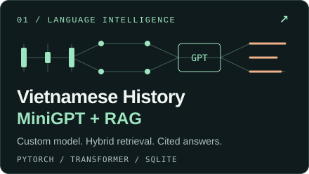
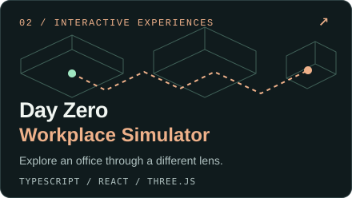

<picture>
  <source media="(prefers-color-scheme: dark)" srcset="assets/hero-dark.svg">
  <source media="(prefers-color-scheme: light)" srcset="assets/hero-light.svg">
  
</picture>

  
  
  

Email: <code>anhnamnknt@gmail.com</code>

# Hi, I'm Nam.

**AI Engineer · Ho Chi Minh City, Vietnam**

I build language models, retrieval systems and applications that put AI to work. My projects span Vietnamese history Q&A, on-device computer vision and interactive web experiences.

I'm studying Information Technology at **HCMC University of Technology and Engineering** and working on internal AI assistants at **CyberAnt Service**. Right now, I'm exploring **AI agents, LLM applications and practical automation**.

*Xin chào! Mình là Phạm Hòa Anh Nam — thích tìm hiểu cách mọi thứ hoạt động và biến ý tưởng thành sản phẩm chạy được.*

## Selected work

  <a href="https://github.com/anhnam26/NLPNew">
    <picture>
      <source media="(prefers-color-scheme: dark)" srcset="assets/project-language-dark.svg">
      <source media="(prefers-color-scheme: light)" srcset="assets/project-language-light.svg">
      
    </picture>
  </a>
  <a href="https://github.com/anhnam26/ADC_Hackathon2026_PU-WIN">
    <picture>
      <source media="(prefers-color-scheme: dark)" srcset="assets/project-dayzero-dark.svg">
      <source media="(prefers-color-scheme: light)" srcset="assets/project-dayzero-light.svg">
      
    </picture>
  </a>

### [Vietnamese History MiniGPT + RAG](https://github.com/anhnam26/NLPNew)

A custom GPT-style Transformer in PyTorch, paired with SQLite/FTS5 and dense retrieval. Includes training workflows, retrieval evaluation, source reporting and tests.

`Python` `PyTorch` `Transformer` `RAG` `SQLite`

### [Day Zero — Workplace Simulator](https://github.com/anhnam26/ADC_Hackathon2026_PU-WIN)

A 3D office experience built around wheelchair navigation, object interactions and collision history for managers to review. Developed for ADC Hackathon 2026.

`TypeScript` `React` `Three.js` `React Three Fiber`

**Also on my workbench:** [Android development](https://github.com/anhnam26/FonosShoppee) · [Web applications](https://github.com/anhnam26/FinalWeb2025) · [All repositories ↗](https://github.com/anhnam26?tab=repositories)

## My toolkit

| Area | What I work with |
| :--- | :--- |
| **Language & AI** | Python · PyTorch · GPT-style Transformers · RAG · LLM APIs · Gradio |
| **Web & 3D** | TypeScript · JavaScript · React · Three.js · Node.js · Express |
| **Data & retrieval** | SQLite · FTS5 · Dense embeddings · Hybrid search · PostgreSQL |
| **Vision & mobile** | Java · Android · MediaPipe · Firebase |

## The build log

<a href="https://github.com/anhnam26?tab=overview">
  <picture>
    <source media="(prefers-color-scheme: dark)" srcset="assets/activity-dark.svg">
    <source media="(prefers-color-scheme: light)" srcset="assets/activity-light.svg">
    
  </picture>
</a>

A dated snapshot of my GitHub activity. [See current activity ↗](https://github.com/anhnam26?tab=overview)

## Let's build something useful.

I'm happy to exchange ideas about **RAG, AI agents, language models and computer vision**, or collaborate on a project with a practical problem to solve.

[Message me on Facebook ↗](https://www.facebook.com/anhnamneverdie) · [Compose in Gmail ↗](https://mail.google.com/mail/?view=cm&fs=1&to=anhnamnknt%40gmail.com)

---

Built with curiosity. Shared in the open.

