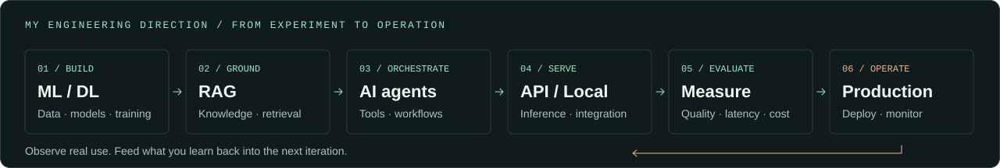

<picture>
  <source media="(prefers-color-scheme: dark)" srcset="assets/hero-dark.svg">
  <source media="(prefers-color-scheme: light)" srcset="assets/hero-light.svg">
  
</picture>

  
  
  

Email: <code>anhnamnknt@gmail.com</code>

# Phạm Hòa Anh Nam

**AI Engineer · AI agents & RAG · LLM APIs & Local AI · ML/DL · Production AI**

I'm developing AI systems that connect **models, knowledge and tools** to real applications. My direction is **production AI**: taking ideas from experiments to systems that can be deployed, evaluated and improved in everyday use.

Based in **Ho Chi Minh City, Vietnam**. Studying Information Technology at **HCMC University of Technology and Engineering**.

*Mình tập trung phát triển theo hướng AI Engineer: xây dựng AI agents, RAG, ứng dụng LLM qua API hoặc chạy local, củng cố ML/DL và đưa AI vào production.*

## What I'm focused on

| Focus | What I'm working toward |
| :--- | :--- |
| **AI agents** | Tool use, workflow orchestration, state management and automation that can complete useful tasks. |
| **RAG** | Connecting AI to real knowledge: data preparation, chunking, embeddings, hybrid retrieval, reranking and source-grounded answers. |
| **LLM APIs** | Integrating language models into applications with structured outputs, streaming and practical cost/latency trade-offs. |
| **Local AI** | Running and serving models locally, exploring quantization and working within CPU/GPU memory constraints. |
| **ML / Deep Learning** | Building stronger foundations in PyTorch, model architectures, training, fine-tuning and evaluation. |
| **Production AI** | Serving APIs, repeatable deployment, evaluation, logging, monitoring and reliability beyond the prototype. |

**My foundations:** `Python` `PyTorch` `SQL / SQLite` `Node.js` `TypeScript`

## From prototype to production

The engineering workflow I'm developing:

<picture>
  <source media="(prefers-color-scheme: dark)" srcset="assets/production-dark.svg">
  <source media="(prefers-color-scheme: light)" srcset="assets/production-light.svg">
  
</picture>

I want to build AI that people can actually use: **grounded answers, purposeful automation and dependable applications**. That means thinking about the data, model behavior, integration and operation together.

## Let's connect

I'd like to exchange ideas and collaborate on **AI agents, RAG, LLM applications, local inference and bringing AI into production**. Use the image buttons above to find me on Facebook, explore my portfolio or compose an email.

## Selected repositories

- **[NLPNew](https://github.com/anhnam26/NLPNew)** — Vietnamese History MiniGPT + RAG: a custom PyTorch Transformer with hybrid retrieval.
- **[Day Zero](https://github.com/anhnam26/ADC_Hackathon2026_PU-WIN)** — A 3D workplace simulator with wheelchair navigation.

[Browse all repositories ↗](https://github.com/anhnam26?tab=repositories)
